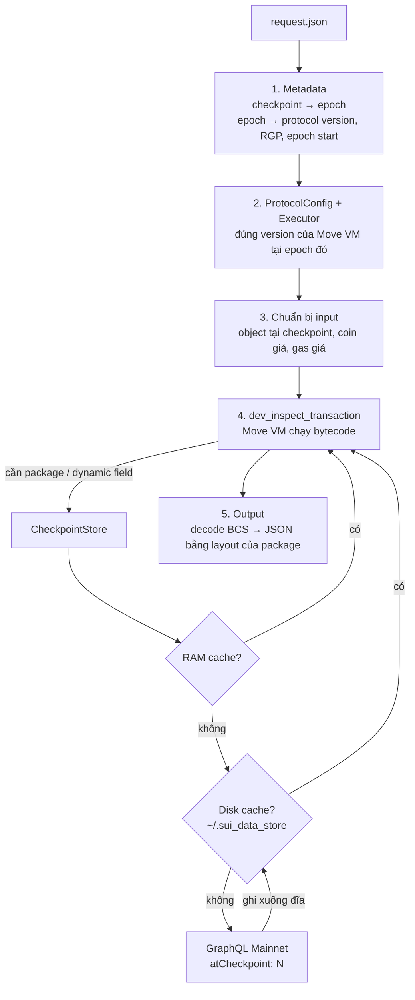

# sui-fork-sim — Sui Historical Simulator

Fork trạng thái Sui Mainnet tại một checkpoint bất kỳ trong quá khứ, rồi chạy **giao dịch PTB do bạn tự viết** bằng Move VM chính thức của Sui, ngay trên RAM. Không cần fullnode, không cần database.

Kết quả (return values, events, object trước/sau khi chạy) là **ground truth** để kiểm chứng các mô hình toán off-chain (AMM, order book, lending…).

```
cargo build --release
./target/release/sui-fork-sim <request.json> [output.json]   # không có output.json thì in ra stdout
```

---

## 1. Ví dụ nhanh

[examples/custom_ptb.json](examples/custom_ptb.json) là một PTB tự chế: tạo 1,000 DEEP giả → tách 123,456,789 → swap sang USDC trên DeepBook, tại checkpoint `318338539`.

```json
{
  "checkpoint": 318338539,
  "sender": "0x1234",
  "inputs": [
    { "coin": "0xdeeb…::deep::DEEP", "amount": "1000000000" },
    { "pure": "u64", "value": "123456789" },
    { "object": "0xf948…" },
    { "pure": "u64", "value": "0" },
    { "object": "0x6" }
  ],
  "commands": [
    { "split_coins": { "coin": {"Input": 0}, "amounts": [{"Input": 1}] } },
    { "move_call": { "target": "0x2::coin::zero", "type_args": ["0xdeeb…::deep::DEEP"] } },
    { "move_call": {
        "target": "0x2c8d…::pool::swap_exact_base_for_quote",
        "type_args": ["0xdeeb…::deep::DEEP", "0xdba3…::usdc::USDC"],
        "args": [{"Input": 2}, {"NestedResult": [0, 0]}, {"Result": 1}, {"Input": 3}, {"Input": 4}] } }
  ]
}
```

Kết quả: `swap` trả về `[456789 DEEP dư, 1872060 USDC, 0 DEEP]`.

Lấy nhanh số dư các coin trả về:

```
jq -c '[.results[2].return_values[].json.fields.balance.fields.value]' out.json
```

---

## 2. Định dạng request

| Trường | Ý nghĩa |
|---|---|
| `checkpoint` | Checkpoint muốn fork. Mọi object được đọc đúng trạng thái **sau khi** checkpoint này đóng |
| `sender` | Địa chỉ bất kỳ (chấp nhận dạng rút gọn `0x1234`). Không cần private key. Mặc định `0x0` |
| `inputs` | Danh sách input, đánh số 0, 1, 2… |
| `commands` | Danh sách lệnh PTB, đánh số 0, 1, 2… |

### Inputs

| Dạng | Ý nghĩa |
|---|---|
| `{"object": "0x…"}` | Object on-chain, tải tại checkpoint. Shared object mặc định **mutable**, riêng Clock `0x6` và Random `0x8` mặc định immutable. Đổi bằng `"mutable": true/false` |
| `{"coin": "<CoinType>", "amount": "…"}` | `Coin<T>` giả, số dư tuỳ ý, thuộc sở hữu của `sender`, tạo trực tiếp trong RAM |
| `{"pure": "<type>", "value": …}` | Giá trị thuần: `bool`, `u8`…`u256`, `address`, `vector<…>` (lồng được), `0x1::string::String`, `0x1::ascii::String`. Số có thể viết dạng chuỗi hoặc số |
| `{"bcs": "<base64>"}` | BCS thô, dùng cho các kiểu không có ở trên (`Option<T>`, struct…) |

### Commands

| Lệnh | Trường |
|---|---|
| `move_call` | `target` (`0xPKG::module::function`), `type_args` (mảng chuỗi type), `args` |
| `split_coins` | `coin`, `amounts` (mỗi amount là một `u64`) |
| `merge_coins` | `coin`, `sources` |
| `transfer_objects` | `objects`, `address` |
| `make_move_vec` | `type` (tuỳ chọn), `elements` |

### Tham chiếu argument

| Cú pháp | Ý nghĩa |
|---|---|
| `{"Input": i}` | Input thứ i |
| `{"Result": j}` | Kết quả (duy nhất) của lệnh j |
| `{"NestedResult": [j, k]}` | Phần tử thứ k trong kết quả của lệnh j |
| `"GasCoin"` | Gas coin (mock) |

---

## 3. Output

| Trường | Nội dung |
|---|---|
| `checkpoint`, `checkpoint_timestamp`, `epoch`, `protocol_version`, `reference_gas_price` | Metadata của điểm fork |
| `sender`, `mock_coins` | Sender và ID của các coin giả đã tạo |
| `error` | `null` nếu thành công, ngược lại là lỗi từ Move VM (kèm index của command bị lỗi) |
| `effects` | `TransactionEffects` đầy đủ (status, gas, object thay đổi…) |
| `results[j]` | `return_values` và `mutable_reference_outputs` của lệnh j |
| `events` | Event phát ra |
| `loaded_objects` | **Trạng thái TRƯỚC** của mọi object/package/dynamic field mà VM đã chạm tới |
| `written_objects` | **Trạng thái SAU** của mọi object bị ghi |

Mỗi giá trị Move được xuất dạng `{ "type", "bcs" (base64), "json" }`. Trong đó `json` là giá trị đã decode, giữ đầy đủ tên trường theo dạng `{ "type": …, "fields": { … } }`.

---

## 4. Flow hoạt động



### Bước 1 — Metadata
- Hỏi GraphQL xem checkpoint N thuộc epoch nào và đóng lúc nào. Kết quả được cache ở `~/.sui_data_store/checkpoints/N.json`.
- Từ epoch lấy `protocol_version`, `reference_gas_price` và thời điểm bắt đầu epoch, cũng được cache trên đĩa.

### Bước 2 — Protocol config
- `ProtocolConfig::get_for_version(protocol_version, Mainnet)` rồi `sui_execution::executor(...)`.
- Nhờ đó VM chạy đúng bộ luật (gas, giới hạn, feature flag) của epoch tại checkpoint đó, kể cả khi checkpoint rất cũ.

### Bước 3 — Chuẩn bị input
- **Object input:** tải tại `atCheckpoint: N`. Nếu owner là shared, dùng `initial_shared_version` thật của nó để tạo `SharedObject`. Nếu là owned/immutable, dùng `ImmOrOwnedObject` với object ref tại checkpoint.
- **Coin giả:** `MoveObject::new_coin(T, version 1, ID random, amount)`, owner là sender.
- **Gas giả:** giống fullnode khi dev-inspect, một coin SUI ID `0x…ff` với số dư 10^18. Budget là `max_tx_gas` của protocol, giá gas là RGP của epoch. Gas chỉ ảnh hưởng gas coin, không ảnh hưởng kết quả của protocol.

### Bước 4 — Thực thi
- Gọi `executor.dev_inspect_transaction(...)` với `skip_all_checks = true`, đúng như fullnode làm cho dev-inspect.
- Trong lúc chạy, mỗi khi VM cần một package hoặc dynamic field (tick, position, order-book slice, `Table`…), nó gọi vào `CheckpointStore` ([src/store.rs](src/store.rs)):

| Callback của VM | Cách xử lý |
|---|---|
| `get_package_object` | Tải package **tại checkpoint N**. Quan trọng với system package `0x1`/`0x2`/`0x3` vì chúng được nâng cấp theo epoch |
| `read_child_object` (dynamic field) | Tải child **tại checkpoint N**, chỉ chấp nhận nếu `version ≤ child_version_upper_bound` |
| `get_object` | Tải tại checkpoint N |
| `get_object_by_key` | Tải đúng version được yêu cầu |

### Bước 5 — Output
- Return values, events và object được decode từ BCS sang JSON. Layout được lấy từ chính package tại checkpoint đó, nên có đầy đủ tên trường.

---

## 5. Cách xử lý các vấn đề kỹ thuật

**Tận dụng code chính thức của Sui thay vì viết lại.**
- `sui-data-store` (dùng trong `sui-replay-2`) đã có sẵn GraphQL store hỗ trợ truy vấn `atCheckpoint` và disk cache dạng BCS. Tool dùng thẳng `ReadThroughStore<FileSystemStore, DataStore>`.
- Phần adapter nối store vào VM được chỉnh lại từ `sui-replay-2/src/execution.rs`.
- Phần chuẩn bị input và gas làm theo `sui-core/src/transaction_simulation.rs` (code dev-inspect của fullnode), nhưng không phụ thuộc `sui-core` vì crate đó quá nặng.

**Ghim version.**
- Mọi crate Sui được ghim vào tag `mainnet-v1.82.3`, cùng toolchain Rust `1.98.1` (xem [rust-toolchain.toml](rust-toolchain.toml)).
- Move VM, gas model và protocol config vì vậy khớp với mainnet (protocol tối đa 139).

**Dynamic field đúng thời điểm.**
- Child object luôn được đọc tại checkpoint N, không bao giờ lấy bản mới nhất. Lấy bản mới nhất sẽ cho ra version lớn hơn bound, và VM sẽ báo `InvariantViolation`.

**Cache 3 tầng.**
- RAM → đĩa (`~/.sui_data_store`) → GraphQL.
- Dữ liệu lịch sử tại một checkpoint không bao giờ đổi, nên cache vĩnh viễn là an toàn.
- Lần chạy đầu mất khoảng 10–25s vì phải tải từ GraphQL. Các lần sau mất khoảng **0.1s** và không cần mạng; điều này đã được kiểm chứng bằng cách chặn mạng hoàn toàn.

**Hai chi tiết giúp cache thực sự trúng.**
1. **Cache cả "không tồn tại".** Contract thường kiểm tra kiểu "dynamic field này có tồn tại không?". Disk store của Sui chỉ lưu object tìm thấy, nên mỗi lần như vậy lại phải gọi GraphQL. Tool lưu thêm danh sách ID không tồn tại tại checkpoint N vào `~/.sui_data_store/checkpoints/N.missing.json`.
2. **Digest giao dịch cố định** (`0xfefe…`). ID của object mới tạo trong giao dịch được suy ra từ digest. Nếu digest random, mỗi lần chạy sinh ra ID mới, và các lần VM kiểm tra sự tồn tại của chúng không bao giờ trúng cache. Digest cố định còn giúp kết quả chạy lại được y hệt.

---

## 6. Kiểm chứng (Definition of Done)

Giao dịch thật: `3XiyVvc5LewKNkq35kci4HSu63yft2ykJCerYziUn99n`, swap trên DeepBook pool DEEP/USDC tại checkpoint X = `318338540`.
- Trước khi chạy, đã kiểm tra rằng pool và các dynamic field nó đọc có cùng version tại X‑1 và tại thời điểm input của giao dịch, tức là không có giao dịch nào khác trong checkpoint X chạm vào chúng trước.

| Trường hợp | Kết quả |
|---|---|
| X‑1, input 369,022,167 DEEP ([examples/deepbook_swap.json](examples/deepbook_swap.json)) | **5,616,180 USDC**, dư 22,167 DEEP. Khớp 100% với event `OrderFilled` trên chuỗi |
| Dynamic field VM tự tải | PoolInner, order-book slice, Account, đúng version mà giao dịch thật đã đọc |
| X‑1, input mới 50,000 DEEP | Thành công: 758,072,900 USDC qua 4 lệnh khớp, VM tự tải thêm order-book slice |
| PTB tự chế ([examples/custom_ptb.json](examples/custom_ptb.json)) | Thành công: 1,872,060 USDC |

---

## 7. Giới hạn & lưu ý

- **Chỉ đúng tại ranh giới checkpoint.** Muốn khớp với một giao dịch thật ở checkpoint X, giao dịch đó phải là giao dịch đầu tiên trong X chạm vào các object liên quan. Kiểm tra bằng cách so version của object tại X‑1 với input version của giao dịch.
- **Không có kiểm tra như fullnode.** Đây là chế độ dev-inspect: không kiểm tra chữ ký hay quyền sở hữu (dùng được owned object của người khác), và kết quả không cần được tiêu thụ hay drop.
- **Lỗi sai kiểu tham số khó đọc.** Ví dụ truyền `vector<u64>` vào `split_coins`, VM sẽ báo `InvariantViolation` thay vì một lỗi rõ ràng như fullnode.
- **Cập nhật version.** Khi mainnet nâng protocol version vượt quá mức tag hiện tại hỗ trợ, phải cập nhật `tag` trong [Cargo.toml](Cargo.toml) và `channel` trong [rust-toolchain.toml](rust-toolchain.toml) theo tag `mainnet-v…` mới nhất.
- **Package không fallback về bản mới nhất.** Nếu GraphQL không trả về package tại checkpoint, tool báo lỗi. Fallback về bản mới nhất sẽ chạy sai bytecode với system package.
- **Chỉ là CLI đồng bộ.** Tool chưa có web server. Nếu nhúng vào server async (Tokio/Axum), phải gọi bên trong `spawn_blocking`.
- **Mới kiểm chứng với DeepBook.** Các protocol khác (Cetus, lending…) chạy theo cùng cơ chế nhưng chưa được đối chiếu với giao dịch thật.

---

## 8. Cấu trúc mã nguồn

| File | Vai trò |
|---|---|
| [src/main.rs](src/main.rs) | CLI, đọc request, metadata, dựng PTB, coin/gas giả, gọi VM, xuất JSON, kèm unit test mã hoá pure |
| [src/store.rs](src/store.rs) | `CheckpointStore`: implement các trait storage mà Move VM cần, ghim tại checkpoint, kèm cache RAM + negative cache |
| [examples/](examples/) | Request mẫu |
